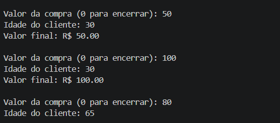

# Desafio PDV com Descontos — Python

Simulador de ponto de venda em linha de comando, desenvolvido para a trilha de Desenvolvimento Back-end.

## O que resolve

Recebe compras sucessivas, aplica regras de desconto conforme a idade e o valor da compra, valida entradas e apresenta um resumo financeiro final.

## Regras implementadas

1. Se a idade for **65 anos ou mais**, aplicar **20%** de desconto.
2. Se o valor **após o primeiro desconto** for **maior que R$ 100,00**, aplicar mais **10%**.
3. Os descontos são sequenciais, não somados diretamente.
4. Informar **0** no valor da compra encerra as entradas e mostra o resumo.

**Exemplo:** compra de R$ 200,00 para cliente de 65 anos → R$ 160,00 após o desconto por idade → **R$ 144,00** ao final.

## Validações

O script rejeita valores de compra negativos ou não numéricos e idades negativas ou não inteiras. Uma entrada inválida leva ao início de uma nova tentativa de compra.

## Como executar

Requisito: Python 3 instalado. Não há dependências externas indicadas no script.

```bash
git clone https://github.com/Isabel828/Desafio-PDV-Python.git
cd Desafio-PDV-Python/nivel_1
python pdv.py
```

No Windows, se necessário, substitua `python` por `py`.

## Organização

```text
Desafio-PDV-Python/
├── nivel_1/
│   ├── pdv.py
│   ├── README.md
│   └── *.png           # Capturas de testes
├── teste_oficial_*.png # Capturas de execução
└── README.md
```

## Testes e evidências

O [README detalhado do nível 1](nivel_1/README.md) apresenta dez cenários com valores esperados, inclusive casos-limite. Há imagens de execução no repositório. Esses cenários estão documentados; não há uma suíte automatizada de testes no código analisado.



## Possíveis melhorias

Isolar o cálculo dos descontos em funções testáveis, adicionar testes automatizados e melhorar a formatação de valores monetários.

**Desenvolvedora:** Isabel Conceição Sousa.
